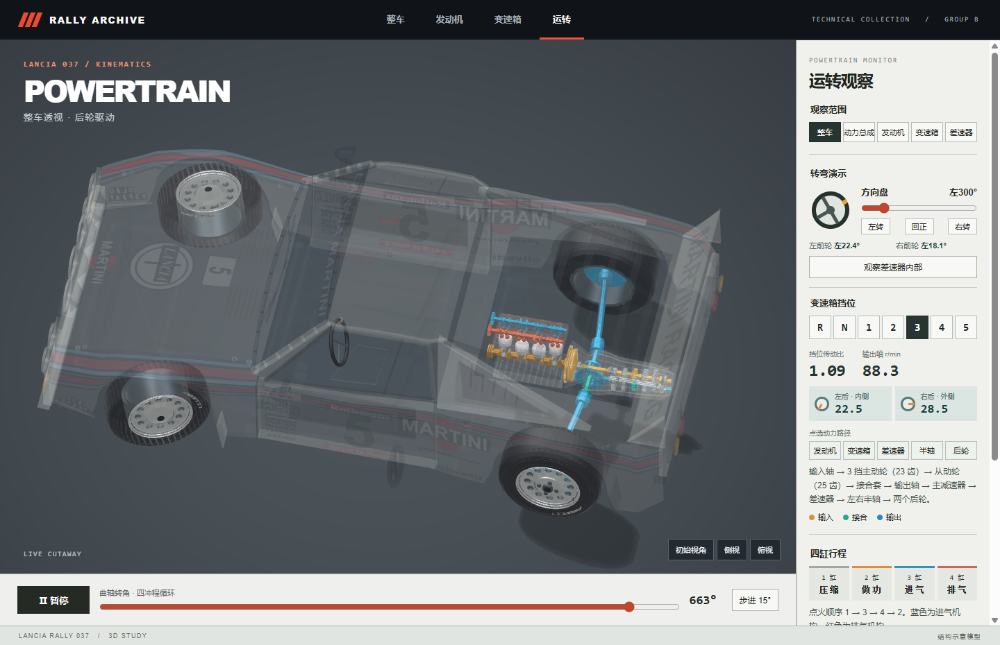
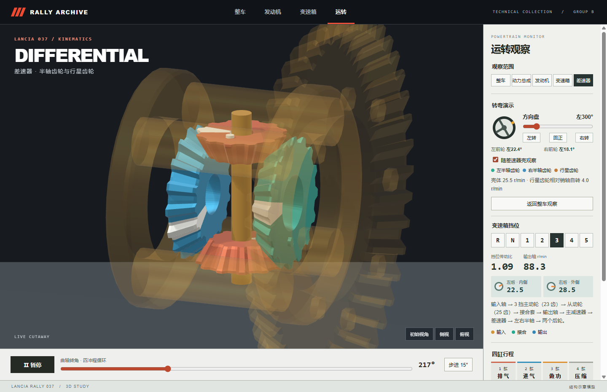

# Lancia Rally 037 · 5 号赛车整车透视与拆解

[在线打开查看器](https://wilsonmah.github.io/lancia-037/)

[直接打开转弯演示](https://wilsonmah.github.io/lancia-037/?demo=turn)

以两张 Rallye de France 5 号车参考图为依据，重绘 Martini 肩线、车门号码、车组姓名和比赛标识，重建多孔轮圈、前灯组、前唇与高位尾翼。车身按名义车长 3.915 m、最宽处 1.850 m、车顶高度 1.245 m 和轴距 2.440 m 校准。可在整车页切换四盏辅助灯。

下载仓库并用支持 WebGL 的浏览器打开 `index.html`，即可离线使用。查看器已内嵌模型和贴图。



## 运转

打开「运转」默认进入整车透视。可以分别调节车身与动力总成外壳的可见度，也可以切换到动力总成、发动机或变速箱近景。点击动力路径中的部件名称，会在模型上标出对应位置。

- 曲轴、四根连杆与活塞由同一曲柄滑块模型驱动。两根凸轮轴以半曲轴转速旋转，带动十六个气门及其弹簧。面板按 1 → 3 → 4 → 2 的点火顺序显示各缸行程。
- 暂停后可拖动 0–720° 曲轴转角，或每次步进 15°。演示转速可在 6、12、24、48、96 r/min 之间切换。
- 选择 1–5 挡时，金色显示输入路径，绿色显示接合齿轮与接合套，蓝色显示输出路径。空挡让输入端和空套齿轮继续旋转。倒挡通过惰轮改变输出方向。
- 13 齿主动锥齿轮驱动 45 齿大齿圈。回正时两个后轮同速，转弯时差速器壳的转速等于两侧后轮转速的平均值。半轴沿两端等速万向节之间的轴线旋转，倒挡显示负轮速。

## 转弯演示

拖动屏幕上的方向盘，或使用滑块、「左转」「回正」「右转」按钮。座舱方向盘和前轮同步转动。面板分别显示两个前轮的转角，以及内、外侧后轮的转速。保持发动机转速和挡位不变，从左转切到右转，可以看到较快的一侧随之对调。

点击「观察差速器内部」可近看行星锥齿轮随壳体公转。勾选「随差速器壳观察」固定观察视角后，齿面上的浅色标记显示行星齿轮在转弯时如何绕自身轴线转动。



## 拆解与模型

整车分为 15 个总成。发动机有 76 个可选零件或小组件，变速箱有 45 个。点击模型或目录可选择部件，通过滑块单独拆出、复原或整体展开。

- [整车 GLB](models/Lancia_037.glb)
- [发动机 GLB](models/Lancia_037_Engine.glb)
- [变速驱动桥 GLB](models/Lancia_037_Transaxle.glb)

GLB 保留独立网格与拆解动画。运转模式的曲柄连杆、气门正时、选挡、转向与差速运动由浏览器实时计算。气门升程取简化的四冲程曲线，齿轮传动比按模型齿数计算。转弯演示采用 15∶1 的示意转向比、阿克曼转向几何和无侧滑滚动条件，展示理想开放式差速器的运动关系。内部尺寸与传动细节为结构示意。

## 从源码重新生成

在仓库根目录使用 Python 3 依次运行以下命令。生成器仅使用 Python 标准库。

```sh
python src/build.py
python src/export_units.py
python src/pack.py
```

生成的 GLB 位于 `models/`，离线查看器为根目录下的 `index.html`。网页界面与运转逻辑在 `src/view.html`，动力总成几何在 `src/power.py`。
