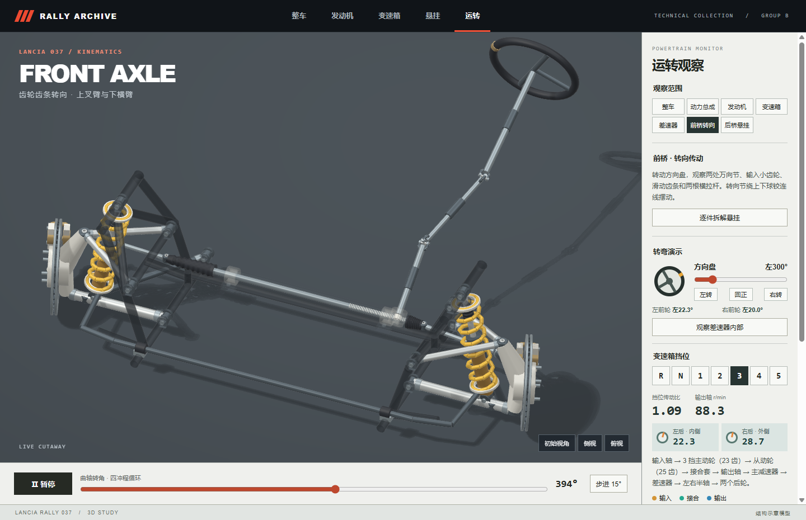

# Wilson's Rally Archive

[中文查看器](https://wilsonmah.github.io/lancia-037/?lang=zh) · [English viewer](https://wilsonmah.github.io/lancia-037/?lang=en)

Lancia Rally 037 · Rallye de France · 5 号赛车整车透视与拆解。右上角可切换语言，页脚「关于 / About」提供中英双语的模型复原说明和权利归属声明。

[直接打开转弯演示](https://wilsonmah.github.io/lancia-037/?demo=turn)

[直接观察前桥转向与后桥悬挂](https://wilsonmah.github.io/lancia-037/?demo=suspension)

以 5 号车为涂装基准，结合三张实车照片调整车头楔形、辅助灯罩、前后翼子板肩线、风挡、后侧进气口与尾翼。按赛事照片重绘 Martini 肩线、车门号码、车组姓名和比赛标识，重建多孔轮圈、前灯组、前唇与高位尾翼。车身按名义车长 3.915 m、最宽处 1.850 m、车顶高度 1.245 m 和轴距 2.440 m 校准。可在整车页切换四盏辅助灯。

下载仓库并用支持 WebGL 的浏览器打开 `index.html`，即可离线使用。查看器已内嵌模型和贴图。


## 运转

打开「运转」默认进入整车透视。可以分别调节车身与动力总成外壳的可见度，也可以切换到动力总成、发动机或变速箱近景。点击动力路径中的部件名称，会在模型上标出对应位置。

- 曲轴、四根连杆与活塞由同一曲柄滑块模型驱动。两根凸轮轴以半曲轴转速旋转，带动十六个气门及其弹簧。面板按 1 → 3 → 4 → 2 的点火顺序显示各缸行程。
- 暂停后可拖动 0–720° 曲轴转角，或每次步进 15°。演示转速可在 6、12、24、48、96 r/min 之间切换。
- 选择 1–5 挡时，金色显示输入路径，绿色显示接合齿轮与接合套，蓝色显示输出路径。空挡让输入端和空套齿轮继续旋转。倒挡通过惰轮改变输出方向。
- 13 齿主动锥齿轮驱动 45 齿大齿圈。回正时两个后轮同速，转弯时差速器壳的转速等于两侧后轮转速的平均值。半轴沿两端等速万向节之间的轴线旋转，倒挡显示负轮速。

## 转弯演示

拖动屏幕上的方向盘，或使用滑块、「左转」「回正」「右转」按钮。座舱方向盘和前轮同步转动。面板分别显示两个前轮的转角，以及内、外侧后轮的转速。保持发动机转速和挡位不变，从左转切到右转，可以看到较快的一侧随之对调。

点击「观察差速器内部」可近看行星锥齿轮随壳体公转。勾选「随差速器壳观察」固定观察视角后，齿面上的浅色标记显示行星齿轮在转弯时如何绕自身轴线转动。


## 前后悬挂与转向

在「运转」中选「前桥转向」，拖动方向盘可以看到转向柱、两处万向节、输入小齿轮、齿条和横拉杆依次传动。半透明的转向机壳露出齿条。每个前轮的转向节绕上下球铰的连线旋转，转角由定长横拉杆的两个球头位置求出。

前桥使用上叉臂、下横臂及纵向定位杆，每侧装同轴弹簧减振器，两侧以横向稳定杆相连。选择「后桥悬挂」可以看到每侧的上叉臂、反置下叉臂、纵向定位杆，以及中央螺旋弹簧前后各一支的独立减振器。在顶部「悬挂」页可以筛选零件、单独取下弹簧或减振器，也可展开整个总成。

| 前桥转向 | 后桥悬挂 |
| --- | --- |
|  |  |

FIA B-210 基础认证表第 701、702、707、804 项及照片 T/U 记录了前后独立悬挂、螺旋弹簧、每个前轮一支和每个后轮两支减振器，以及 16.8∶1 的齿轮齿条转向。模型以该比值校准中位附近的转向几何，再对照裸车架侧照和赛车剖视图布置零件。比赛用车的铰点三维坐标、杆长、安装角和转向机内部尺寸为重建值。悬挂类零件按静态车高展示，方向盘控制前轮转向。[FIA B-210 原始认证表](https://historicdb.fia.com/sites/default/files/car_attachment/1662976801/homologation_form_number_210_group_b.pdf) · [前后导向机构说明](https://en.wikipedia.org/wiki/Lancia_Rally_037#Suspension) · [后桥双减振器资料](https://www.wrcwings.tech/2024/01/02/lancia-rally-037/)

## 拆解与模型

整车分为 15 个总成。发动机有 82 个可选零件或小组件，变速箱有 45 个，悬挂、转向与制动总成有 52 个。点击模型或目录可选择部件，通过滑块单独拆出、复原或整体展开。

### 发动机舱细节

发动机外观按 Tipo 232 AR4 实车发动机舱照片细化：

- 两个独立的金色皱纹漆凸轮轴盖，铸有红色凸起「ABARTH」字样、纵向加强筋和周边紧固螺栓，中间露出火花塞井。
- 红色硅胶火花塞帽与黑色高压线，跨过进气侧凸轮轴盖后由分线卡束成一束，接到进气凸轮轴飞轮端的分电器，另有点火线圈。
- 进气侧为圆筒形焊接铝制稳压腔，带圆顶封头、焊缝、螺栓凸台、六角接头与倒刺管嘴。前端经方形法兰节气门体（含油门摇臂和双回位弹簧）、红色硅胶接头与卡箍，以铝制弯管连到 Volumex 增压器出口。
- 排气歧管改为镀铝钢的哑光银色，各缸带法兰与螺柱。
- 凸轮轴盖通风编织管、带蓝红阳极氧化接头的铝制干式油底壳储油罐，以及外缠金色隔热螺旋的机油管。

- [整车 GLB](models/Lancia_037.glb)
- [发动机 GLB](models/Lancia_037_Engine.glb)
- [变速驱动桥 GLB](models/Lancia_037_Transaxle.glb)
- [悬挂、转向与制动 GLB](models/Lancia_037_Suspension.glb)

GLB 保留独立网格与拆解动画。运转模式的曲柄连杆、气门正时、选挡、转向与差速运动由浏览器实时计算。气门升程取简化的四冲程曲线，传动比按模型齿数计算。转弯轮速按两前轮指向所推算的平均曲率计算，差速器采用理想开放式运动关系。内部尺寸与传动细节为结构示意。

## 从源码重新生成

在仓库根目录使用 Python 3 依次运行以下命令。生成器仅使用 Python 标准库。

```sh
python src/build.py
python src/export_units.py
python src/pack.py
```

生成的 GLB 位于 `models/`，离线查看器为根目录下的 `index.html`。网页界面与运转逻辑在 `src/view.html`，动力总成几何在 `src/power.py`。
