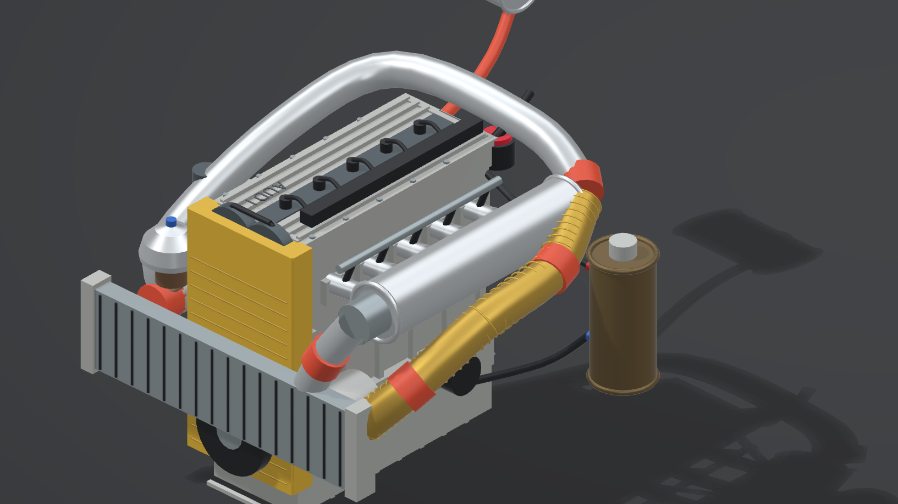
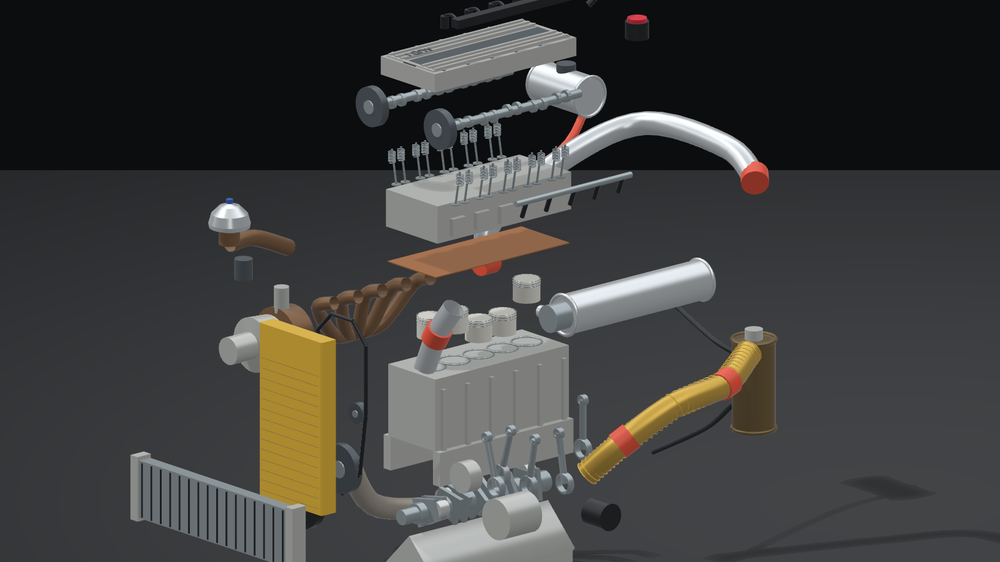
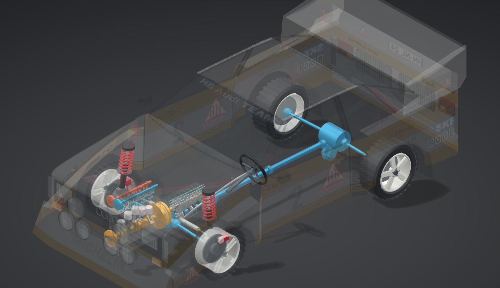
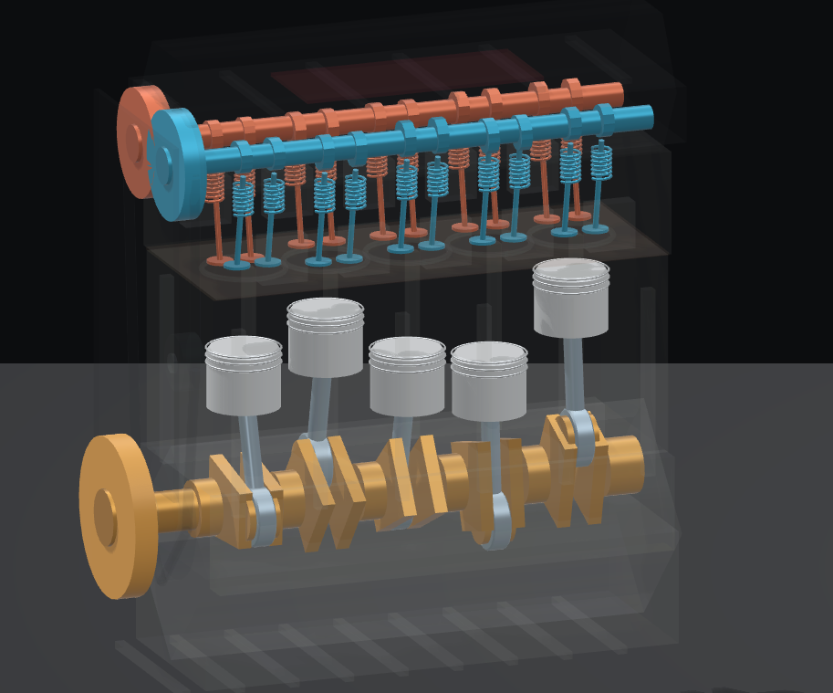

# Audi Sport quattro S1 E2 · Wilson's Group B Archive

[← Back to the catalogue](../../README.md)

[Chinese viewer](https://wilsonmah.github.io/group_b_archive/cars/audi-quattro-s1/?lang=zh) · [English viewer](https://wilsonmah.github.io/group_b_archive/cars/audi-quattro-s1/?lang=en)


The 1985 E2 evolution, HB Audi Team car Nº 2 (Walter Röhrl / Christian Geistdörfer). Download the repository and open `index.html` in this folder in any WebGL browser to use it offline; the viewer embeds the model and textures.

## Body and livery

- **Side profile:** scaled from a square-on side photograph of car Nº 2, using the 2.224 m wheelbase. The roof, windscreen, bonnet, tail and rear wing were checked against the photograph in an overlay. The roof is about 1.30 m high, the side-window sill sits at 0.86–0.92 m, and the door shut lines are 0.54 m behind and 0.62 m ahead of the wheelbase centre.
- **Plan widths:** from a four-view drawing with a 1 m scale bar. Half-widths are 0.925 m at the box flares (about 1.85 m overall), 0.835 m at the doors, 0.785 m at the cabin base and 0.60 m at the roof.
- **E2 aero kit:**
  - **Front wings:** a sloping ledge runs in a straight line from 0.74 m above the front wheel down to the splitter at 0.27 m.
  - **Splitter:** it reaches about 2.07 m ahead of the wheelbase centre.
  - **Rear window:** a fastback that runs almost to the short boot lid.
  - **Rear wing:** about 0.75 m in chord, with a trailing edge about 1.31 m high, carried on two end plates.
  - **Side intakes:** black louvred intakes behind the doors feed the rear-mounted radiators.
- **Livery bands:** layered as in the photographs, from top to bottom: yellow above the waist, orange-and-white pinstripes, a white middle band, pinstripes again, then yellow at the bottom. Red, taupe and black diagonal bands run across the C-pillars and the bonnet.
- **Decals:** placed at their photographed positions and kept at the aspect ratio of their artwork. They are:
  - MICHELIN, Castrol, Audi Sport, quattro, SKF, BOGE and BOSCH fuel injection
  - HB international
  - the crew names and the number 2
- **Nose:** calibrated against the head-on photographs and the front view of the four-view drawing.
  - The black grille panel spans ±0.76 m, with rectangular headlamps centred 0.60 m from the centreline and white body corners outboard.
  - Below it is a yellow valance, with the amber indicators under the headlamps.
  - The lamp pod carries two Bosch long-range lamps at ±0.32 m, level with the headlamps, over four Hella fog lamps in two pairs at ±0.20 m and ±0.43 m, level with the valance.
- **Tail:** calibrated against the rear photographs.
  - A raised white box under the wing carries the IN-NL 24 plate and the HB logo.
  - Below it are a yellow Audi / quattro band and two separate rounded radiator outlets in a white surround, crossed by a pinstripe pair.
  - At the outer ends are dark smoked tail lamps, with black vents on the backs of the flares.
  - Lower down are a perforated exhaust-air strip and a yellow lip.

## Mechanicals

### Engine bay

The engine and bay are detailed from photographs of preserved S1 E2 cars (including the Bonhams auction car):

- **Cam cover:** grey cast alloy with longitudinal ribs, perimeter bolts and raised cast AUDI lettering at the front. The five spark-plug boots sit in a row down the middle, with their leads running into a black loom channel on the intake side and on to the distributor at the back of the head.
- **Charge air:** from the KKK compressor on the right, a polished alloy crossover pipe climbs along the exhaust side and crosses behind the cam cover. On the intake side a gold heat-wrapped pipe with red silicone couplers runs forward to the front intercooler. A polished feed pipe takes the air back into the long polished plenum and its five runners.
- **Turbo side:** a polished wastegate dome with a blue anodised cap sits ahead of the turbo, beside the exhaust manifold and downpipe; there is also a blow-off valve.
- **Front of the engine:** a yellow Kevlar timing-belt cover over the toothed belt and pulleys.
- **Ancillaries:** a bronze dry-sump oil tank with blue and red anodised fittings and braided lines at the front left, and a polished coolant header tank at the bulkhead.
- **Bay:** painted white, with white strut towers joined by a polished strut brace and diagonal braces to the bulkhead, three brake and clutch fluid reservoirs with red caps, and a mesh cabin-air intake.



**Teardown order:** the engine explodes in stacked order.

- **Down:** the sump and crankshaft.
- **Out to the intake side:** the connecting rods, plenum, heat-wrapped pipe and oil tank.
- **Up:** the pistons, then the head gasket, head, valves, camshafts, cam cover and plug loom.
- **Out to the right:** the exhaust manifold, turbo, wastegate and downpipe.
- **Forward:** the timing belt, the Kevlar cover and the intercooler.
- **Up and back:** the charge-air crossover.



### Assemblies


- **Engine (48 parts):** a 2,110 cm³ (79.3 × 85.4 mm) twenty-valve all-alloy inline-five, mounted longitudinally ahead of the front axle.
  - The crank throws are laid out for the 1-2-4-5-3 firing order, 144° apart.
  - On the right are the exhaust manifold, KKK turbocharger and wastegate; on the left the intake plenum, runners and injectors; at the front the intercooler.
  - The block, sump, crankshaft, five rod-and-piston sets, head, both camshafts, each cylinder's intake and exhaust valves, timing belt and more can each be removed on their own.
- **quattro drivetrain (36 parts):** a twin-plate clutch, then a six-speed gearbox with the front differential built into its nose and the centre differential at its tail, a two-piece propshaft, the rear differential and four driveshafts. Each gear pair, the reverse idler, the four sliding collars and their selector forks are separate parts.
- **Suspension (23 parts):** MacPherson struts and lower wishbones front and rear, with ventilated discs, four-piston calipers, anti-roll bars and rack-and-pinion steering.
- **E2 rear-mounted cooling:** the water radiator and the oil and gearbox coolers move into the boot to improve the S1's nose-heavy weight distribution. The side intakes feed them air, and electric fans push it out through the tail grilles.
- Internal structures without public drawings are reconstructed from public sources, for study and visual reference only.

## Motion study



The "运转 / Run" tab opens a see-through view of the car. You can switch to close-ups of the powertrain, the engine or the gearbox, and set the visibility of the body and of the engine and gearbox casings separately.

- **Crank train:** the crankshaft, five connecting rods and pistons are driven by one slider-crank model, with the crank throws 72° apart. The two camshafts turn at half crank speed and open each cylinder's valves. The panel shows each cylinder's stroke in the firing order 1 → 2 → 4 → 5 → 3, one firing every 144°. When paused you can drag the crank angle through 0–720° or step it 15° at a time.
- **Gearbox:** in gears 1–6 the input path is shown in gold, the engaged gear pair and its sliding collar in green, and the output path in blue. Reverse runs through an idler. Ratios come from the modelled tooth counts (2.58 in first to 0.87 in sixth), with a 37:9 final drive.
- **quattro drive:** the output shaft turns the centre differential, which drives the front differential and, through the two-piece propshaft, the rear differential. Each of the four driveshafts and wheels turns at its own speed.
- **Steering:** drag the on-screen steering wheel, or use the slider or the left / centre / right buttons. The front wheels follow Ackermann geometry at 15° of steering wheel per degree of road wheel, so the inner front wheel turns further than the outer one (27.6° against 21.2° with 360° of lock). With ideal open differentials, every wheel rolls at the speed of its own turning radius; the panel shows the two rear wheel speeds.
- **Not modelled:** wheel travel, which the Lancia 037 has, is not modelled for the S1.



## Model files

- [Full car GLB](models/Audi_Sport_quattro_S1_E2.glb)
- [Engine GLB](models/Audi_S1_E2_Engine.glb)
- [quattro drivetrain GLB](models/Audi_S1_E2_Drivetrain.glb)
- [Suspension, steering and brakes GLB](models/Audi_S1_E2_Suspension.glb)

To rebuild, run this in this folder with Python 3 (standard library only):

```sh
python src/build.py && python src/export_units.py && python src/pack.py
```

The decal atlas is drawn by `src/atlas.ps1` (Windows PowerShell).

## Sources

- **Four-view drawing:** [GetOutlines · 1984 Audi Sport Quattro S1 Coupe v2](https://getoutlines.com/blueprints/6634/1984-audi-sport-quattro-s1-coupe-blueprints), with a 1 m scale bar.
- **Photographs:** Wikimedia Commons images under Creative Commons licences, used only for comparison and not distributed with the repository:
  - Robert Basic's series of car Nº 2 (CC BY-SA 2.0)
  - Cs-wolves (CC BY-SA 4.0)
  - Brian Snelson (CC BY 2.0), among others
- **Dimensions and history:**
  - [Motor Sport · Quattro S1 & E2](https://www.motorsportmagazine.com/archive/article/november-2004/58/quattro-s1-e2)
  - [John Davenport · S1 vs E2](https://www.ableitet.no/twentyS1/s1vse2.htm)
  - [FIA historic database · Sport quattro S1 (homologation 264)](https://historicdb.fia.com/car/audi-sport-quattro-s1)

Audi, quattro and the livery and sponsor names (HB, Michelin and others) belong to their respective rights holders. This project is an unofficial, independent technical exhibition.
