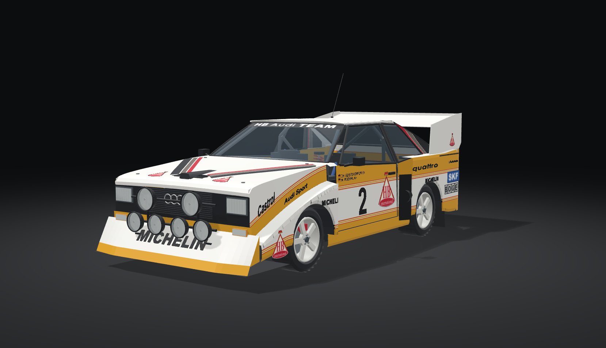

# Audi Sport quattro S1 E2 · Wilson's Group B Archive

[← Back to the catalogue](../../README.md)

[Chinese viewer](https://wilsonmah.github.io/group_b_archive/cars/audi-quattro-s1/?lang=zh) · [English viewer](https://wilsonmah.github.io/group_b_archive/cars/audi-quattro-s1/?lang=en)



The 1985 E2 evolution, HB Audi Team car Nº 2 (Walter Röhrl / Christian Geistdörfer). Download the repository and open `index.html` in this folder in any WebGL browser to use it offline; the viewer embeds the model and textures.

## Body and livery

- **Side profile:** scaled from a square-on side photograph of car Nº 2, using the 2.224 m wheelbase. The roof, windscreen, bonnet, tail and rear wing were checked against the photograph in an overlay. The roof is about 1.30 m high, the side-window sill sits at 0.86–0.92 m, and the door shut lines are 0.54 m behind and 0.62 m ahead of the wheelbase centre.
- **Plan widths:** from a four-view drawing with a 1 m scale bar. Half-widths are 0.925 m at the box flares (about 1.85 m overall), 0.835 m at the doors, 0.785 m at the cabin base and 0.60 m at the roof.
- **E2 aero kit:**
  - **Front wings:** a sloping ledge runs in a straight line from 0.74 m above the front wheel down to the splitter at 0.27 m.
  - **Splitter:** it reaches about 2.07 m ahead of the wheelbase centre.
  - **Rear window:** a fastback that runs almost to the short boot lid.
  - **Rear wing:** about 0.75 m in chord, with a trailing edge about 1.31 m high, carried on two end plates.
  - **Side intakes:** black louvred intakes behind the doors feed the rear-mounted radiators.
- **Livery bands:** layered as in the photographs, from top to bottom: yellow above the waist, orange-and-white pinstripes, a white middle band, pinstripes again, then yellow at the bottom. Red, taupe and black diagonal bands run across the C-pillars and the bonnet.
- **Decals:** placed at their photographed positions and kept at the aspect ratio of their artwork. They are:
  - MICHELIN, Castrol, Audi Sport, quattro, SKF, BOGE and BOSCH fuel injection
  - HB international
  - the crew names and the number 2
- **Nose:** black grille with rectangular headlamps, and below it a yellow valance with the indicators. The lamp pod in front carries two Bosch long-range lamps above four Hella fog lamps.
- **Tail:** two black radiator outlet grilles, smoked tail lamps, a perforated exhaust-air strip and the IN-NL 24 registration plate.

## Mechanicals

- **Engine (30 parts):** a 2,110 cm³ (79.3 × 85.4 mm) twenty-valve all-alloy inline-five, mounted longitudinally ahead of the front axle.
  - The crank throws are laid out for the 1-2-4-5-3 firing order, 144° apart.
  - On the right are the exhaust manifold, KKK turbocharger and wastegate; on the left the intake plenum, runners and injectors; at the front the intercooler.
  - The block, sump, crankshaft, five rod-and-piston sets, head, camshafts, valves, timing belt and more can each be removed on their own.
- **quattro drivetrain (13 parts):** a twin-plate clutch, then a six-speed gearbox with the front differential built into its nose and the centre differential at its tail, a two-piece propshaft, the rear differential and four driveshafts.
- **Suspension (23 parts):** MacPherson struts and lower wishbones front and rear, with ventilated discs, four-piston calipers, anti-roll bars and rack-and-pinion steering.
- **E2 rear-mounted cooling:** the water radiator and the oil and gearbox coolers move into the boot to improve the S1's nose-heavy weight distribution. The side intakes feed them air, and electric fans push it out through the tail grilles.
- Internal structures without public drawings are reconstructed from public sources, for study and visual reference only.
- The Run mode (five-cylinder firing and quattro power flow) is not built for this car yet.

## Model files

- [Full car GLB](models/Audi_Sport_quattro_S1_E2.glb)
- [Engine GLB](models/Audi_S1_E2_Engine.glb)
- [quattro drivetrain GLB](models/Audi_S1_E2_Drivetrain.glb)
- [Suspension, steering and brakes GLB](models/Audi_S1_E2_Suspension.glb)

To rebuild, run this in this folder with Python 3 (standard library only):

```sh
python src/build.py && python src/export_units.py && python src/pack.py
```

The decal atlas is drawn by `src/atlas.ps1` (Windows PowerShell).

## Sources

- **Four-view drawing:** [GetOutlines · 1984 Audi Sport Quattro S1 Coupe v2](https://getoutlines.com/blueprints/6634/1984-audi-sport-quattro-s1-coupe-blueprints), with a 1 m scale bar.
- **Photographs:** Wikimedia Commons images under Creative Commons licences, used only for comparison and not distributed with the repository:
  - Robert Basic's series of car Nº 2 (CC BY-SA 2.0)
  - Cs-wolves (CC BY-SA 4.0)
  - Brian Snelson (CC BY 2.0), among others
- **Dimensions and history:**
  - [Motor Sport · Quattro S1 & E2](https://www.motorsportmagazine.com/archive/article/november-2004/58/quattro-s1-e2)
  - [John Davenport · S1 vs E2](https://www.ableitet.no/twentyS1/s1vse2.htm)
  - [FIA historic database · Sport quattro S1 (homologation 264)](https://historicdb.fia.com/car/audi-sport-quattro-s1)

Audi, quattro and the livery and sponsor names (HB, Michelin and others) belong to their respective rights holders. This project is an unofficial, independent technical exhibition.
