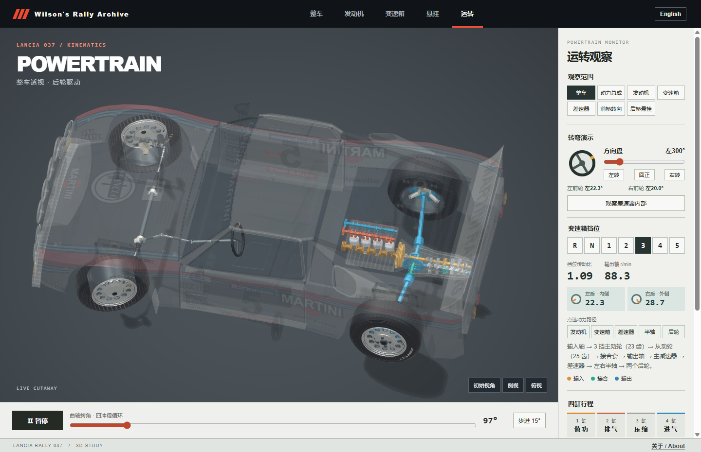
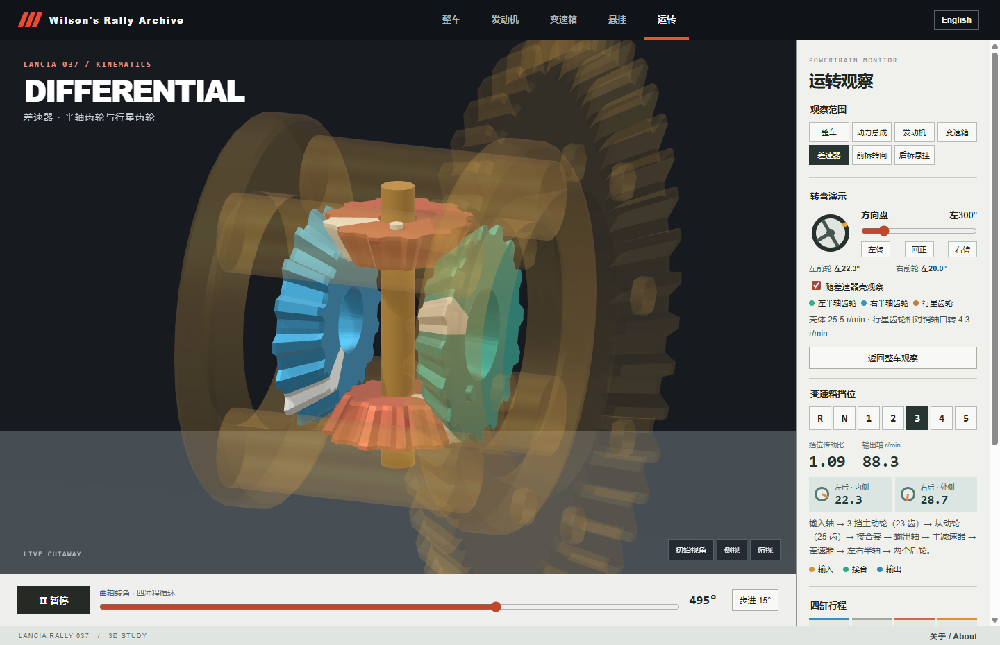
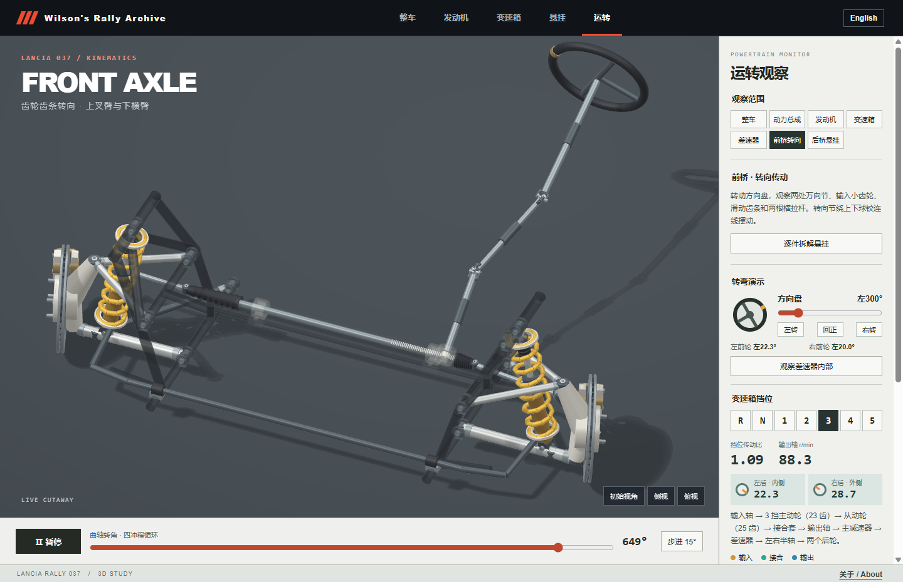
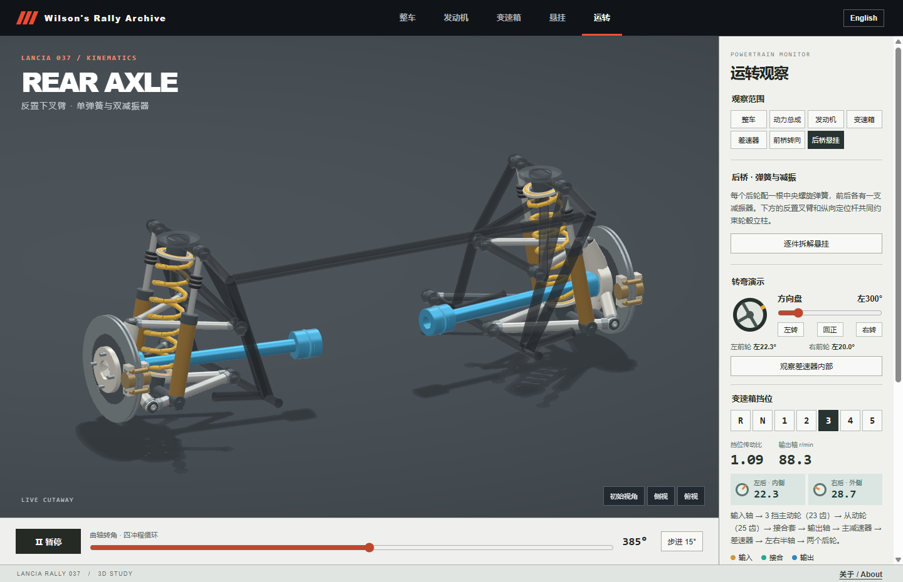
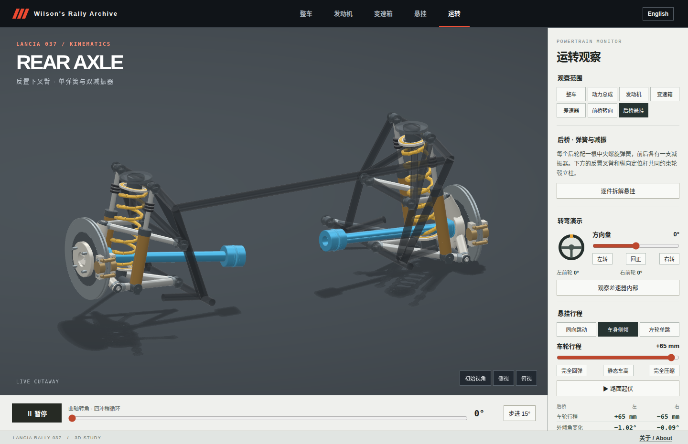

# Lancia Rally 037 · Wilson's Group B Archive

[← Back to the catalogue](../../README.md)

[Chinese viewer](https://wilsonmah.github.io/group_b_archive/cars/lancia-037/?lang=zh) · [English viewer](https://wilsonmah.github.io/group_b_archive/cars/lancia-037/?lang=en)

A see-through, take-apart study of the Lancia Rally 037, Rallye de France, car Nº 5. Switch languages at the top right; the "关于 / About" link in the footer carries bilingual notes on how the model was reconstructed and who owns the rights.

[Open the turning demo](https://wilsonmah.github.io/group_b_archive/cars/lancia-037/?demo=turn) · [Open the front steering and rear suspension](https://wilsonmah.github.io/group_b_archive/cars/lancia-037/?demo=suspension) · [Open the suspension travel demo](https://wilsonmah.github.io/group_b_archive/cars/lancia-037/?demo=travel)

## Body and livery

The livery follows car Nº 5. Period photographs set the wedge nose, the auxiliary lamp pod, the front and rear wing shoulders, the windscreen, the rear side intakes and the rear wing. The Martini ribbons, door number, crew names and event graphics are redrawn from rally photographs, and the multi-hole wheels, headlamps, front lip and high rear wing are rebuilt.

- **Overall size:** calibrated to a nominal length of 3.915 m, maximum width 1.850 m, roof height 1.245 m and wheelbase 2.440 m.
- **Side profile:** taken from two square-on side photographs, scaled by the 2.440 m axle spacing and the tyre radius. The roof, windscreen, wings and rear wing were checked every 5.5 cm and are generally within ±1 cm (the wipers and aerial are the exceptions).
- **Waist and wings:** the waist is level at about 0.845 m; the front wing tops sit at about 0.84 m and fall to about 0.62 m at the nose.
- **Windscreen:** a wraparound screen. The base is about 0.82 m ahead of the wheelbase centre across the middle and sweeps back to the A-pillar feet beside the mirrors at about 0.62 m; the header sits about 0.19 m ahead, so the upper screen matches the side photograph.
- **Doors and glass:** door shut lines at 0.27 m behind and 0.72 m ahead of the centre. The door glass rises steeply from just behind the mirror (0.49 m) to a rounded corner at 0.19 m, with its top edge falling slightly forward with the roof. The A-pillars and cant rails are single body-colour panels. Behind the B-pillar is a fixed quarter light whose rear edge leans with the flying buttress.
- **Roof:** a single shallow crown, highest at about 1.226 m (about 1.24 m including the roof scoop), falling to the windscreen and the engine cover.
- **Overhangs and wing:** front overhang about 0.85 m, rear about 0.62 m. The rear wing rises at about 26° from behind the engine-cover glass to fin tips about 1.16 m high, with raked fin trailing edges.
- **Front view:** the cabin narrows as in the head-on photograph. The screen header is about 1.03 m wide, the A-pillars and side glass lean in clearly, and broad wing shoulders remain on either side. Three separate louvred outlets sit ahead of the windscreen, and there is a low intake at the front of the roof.
- **Ride height:** ride height and sill colour vary between cars, so the lower body edge keeps the original setting.
- **Construction:** the body is modelled directly to the measured dimensions, with no longitudinal stretching or tail compression. Sections and the waistline use monotone cubic interpolation to avoid creases.
- **Decals:** every graphic keeps its artwork's own aspect ratio. The MARTINI logo is 0.53 m wide with a true-circle 0.28 m disc; the sponsor panel on the door is 0.22 × 0.28 m; the MARTINI RACING wing graphic, the nose PIRELLI, the roundel and the rally plate are undistorted. The Martini ribbons are about 0.13 m wide on the doors and widen to about 0.21 m at the nose; the ribbons on the wing tops turn up onto the shoulder within 0.14 m of the door seam, with no break or S-bend.
- **Nose and tail layout:** the plan, front and rear layouts follow the [GetOutlines 1983 Lancia Rally 037 Martini four-view drawing](https://getoutlines.com/blueprints/9680/1983-lancia-rally-037-martini-coupe-blueprints) for relative proportions only; absolute dimensions still come from the photographs.
- **Bonnet:** from the studio photographs of Nº 5, the Goodwood photograph and the head-on photograph. The front clamshell falls in one straight line from the screen base (about 0.87 m) to the nose (about 0.63 m), rounding into the lamp brow only in the last 0.2 m, with no hump over the front wheel. The bonnet is a flat panel almost flush with the wings (1.5 cm lower at the screen base, 0.5 cm at the nose). Its shut lines are straight in plan, opening from 0.43 m off the centreline at the screen to 0.50 m at the nose, rather than bowing out with the wheel arches. The inner edge of the ribbons sits on the shut lines, and there is a pair of pins at each end. Three 0.24 m louvred outlets sit in a row right against the screen base, with the rally plate and LANCIA roundel immediately ahead.
- **Front fascia:** the headlamp pairs are centred 0.565 m from the centreline at a height of about 0.51 m; the grille fills the full lamp height between them; the lower intake runs from 0.29 to 0.42 m. The nose's plan curve no longer shears the lamps.
- **Tail:** from the Goodwood and Tour de Corse rear photographs. The wing stands on full-height fins, with a vertical white face about 0.24 m tall (LANCIA MARTINI) under its trailing edge. Below that, from 0.51 to 0.91 m, is a full-width fine black wire-mesh panel you can see into the engine bay through, with the plate at the top, PIRELLI in the middle and a round lamp in each lower corner. Under the panel is a thin white beam; below that the tail is open, showing the gearbox and exhaust. Large white flaps hang at the rear corners. The engine cover is clear glass with a louvred outlet in each front corner, without cross bars. The tail end stays close to full body width.
- The four auxiliary lamps can be switched on the vehicle page.

Download the repository and open `index.html` in this folder in any WebGL browser to use it offline; the viewer embeds the model and textures.



## Motion study

The "运转 / Run" tab opens a see-through view of the whole car. You can set the visibility of the body and the powertrain casings separately, or switch to close-ups of the powertrain, engine or gearbox. Clicking a component in the power path highlights it on the model.

- The crankshaft, four connecting rods and pistons are driven by one slider-crank model. The two camshafts turn at half crank speed and drive the sixteen valves and their springs. The panel shows each cylinder's stroke in the firing order 1 → 3 → 4 → 2.
- When paused you can drag the crank angle through 0–720° or step it 15° at a time. The demo speed can be set to 6, 12, 24, 48 or 96 rpm.
- In gears 1–5 the input path is shown in gold, the engaged gear and sliding collar in green, and the output path in blue. In neutral the input side and the free-running gears keep turning. Reverse changes the output direction through an idler.
- A 13-tooth drive pinion turns a 45-tooth crownwheel. With the wheel straight both rear wheels turn at the same speed; in a turn the differential carrier turns at the average of the two rear wheels. The halfshafts rotate about the axis between their constant-velocity joints, and reverse shows negative wheel speed.

## Turning demo

Drag the on-screen steering wheel, or use the slider or the left / centre / right buttons. The cockpit steering wheel and the front wheels turn together. The panel shows each front wheel's angle and the speed of the inner and outer rear wheels. Keep the engine speed and gear constant and switch from a left to a right turn to see the faster side swap over.

"Look inside the differential" zooms in on the spider gears orbiting with the carrier. With "follow the differential carrier" ticked the view rides with the carrier, and light marks on the gear teeth show how the spider gears spin on their own axes in a turn.



## Suspension and steering

In the Run tab, choose "前桥转向 / Front steering" and drag the steering wheel to watch the column, its two universal joints, the input pinion, the rack and the track rods move in turn. The translucent rack housing shows the rack. Each front upright turns about the line through its upper and lower ball joints, and its angle is solved from the positions of the two ball joints on a fixed-length track rod.

The front axle uses upper wishbones, lower transverse arms and longitudinal locating links, with a coil-over damper on each side and an anti-roll bar between them. "后桥悬挂 / Rear suspension" shows the upper wishbone, inverted lower wishbone and longitudinal link on each side, plus a central coil spring with a separate damper ahead of and behind it. On the "悬挂 / Suspension" tab you can filter parts, remove a spring or damper on its own, or explode the whole assembly.

| Front steering | Rear suspension |
| --- | --- |
|  |  |

Items 701, 702, 707 and 804 and photos T/U of FIA basic homologation form B-210 record independent front and rear suspension, coil springs, one damper per front wheel and two per rear wheel, and 16.8:1 rack-and-pinion steering. The model calibrates the steering geometry around centre to that ratio, then places the parts against side photographs of the bare chassis and cutaway drawings of the rally car. The pivot coordinates, link lengths, mounting angles and rack internals of the competition car are reconstructions. Suspension parts are shown at static ride height, and the steering wheel steers the front wheels. [Original FIA B-210 homologation form](https://historicdb.fia.com/sites/default/files/car_attachment/1662976801/homologation_form_number_210_group_b.pdf) · [Front and rear suspension layout](https://en.wikipedia.org/wiki/Lancia_Rally_037#Suspension) · [Rear twin-damper notes](https://www.wrcwings.tech/2024/01/02/lancia-rally-037/)

### Suspension travel

In the Run tab's vehicle, front steering and rear suspension views, the "悬挂行程 / Wheel travel" panel moves the wheels between −70 mm (full rebound) and +70 mm (full bump):

- "Heave" moves both wheels together, "Roll" moves the two sides in opposite directions, and "Left wheel" moves only the left wheel.
- "Rough road" plays a continuous sequence of bumps, with the rear axle reaching each bump slightly after the front.
- Every wishbone's inner pivots run fore and aft, so each wheel is solved as a four-bar linkage in the transverse plane: the lower arm turns about its inner pivot, the upright keeps the ball-joint spacing, and the upper wishbone follows. Springs and dampers extend and compress along their axes, while the longitudinal links, rear halfshafts and front track rods swing with them; steering and wheel travel can act at the same time.
- The panel shows wheel travel, camber change, spring length change and wheel-centre lateral shift on both sides. With the reconstructed pivots, 70 mm of bump gives about −2.7° of camber at the front and about −1.2° at the rear, with about 50 mm of spring compression.
- Bump steer and anti-roll bar twist are not calculated.



## Teardown and models

The car is split into 15 assemblies. The engine has 84 selectable parts or sub-assemblies, the transaxle 45, and the suspension, steering and brakes 52. Click the model or the list to select a part, then use the slider to remove it on its own, put it back or explode everything.

### Engine bay detail

The engine's exterior is refined from photographs of a real Tipo 232 AR4 engine bay:

- Two separate gold crinkle-finish cam covers with raised red cast "ABARTH" lettering, longitudinal ribs and perimeter bolts, with the spark plug wells exposed between them.
- Red silicone plug caps and black HT leads, bundled by a separator clip over the intake-side cam cover and run to the distributor at the flywheel end of the intake camshaft, plus an ignition coil.
- On the intake side, a welded cylindrical aluminium plenum with domed end caps, weld seams, bolt bosses, hex fittings and barbed spigots. At its front, a square-flanged throttle body (with throttle lever and twin return springs), a red silicone coupling with clamps and a bent aluminium tube lead to the Volumex supercharger outlet.
- The supercharger inlet has a cast aluminium end cover and elbow, connected by a black corrugated rubber hose to a cylindrical aluminium air filter on the intake side. The filter has a domed end cap, rolled stiffening ribs, a black rubber band, steel mounting straps and a wing nut at the end.
- The exhaust manifold is matt silver aluminised steel, with a flange and studs at each cylinder.
- A braided cam-cover breather hose, an aluminium dry-sump oil tank with blue and red anodised fittings, and oil lines wrapped in gold heat-shield spiral.

Downloads:

- [Full car GLB](models/Lancia_037.glb)
- [Engine GLB](models/Lancia_037_Engine.glb)
- [Transaxle GLB](models/Lancia_037_Transaxle.glb)
- [Suspension, steering and brakes GLB](models/Lancia_037_Suspension.glb)

The GLBs keep separate meshes and the teardown animations. The Run mode's crank train, valve timing, gear selection, steering and differential motion are calculated live in the browser. Valve lift uses a simplified four-stroke curve and gear ratios come from the modelled tooth counts. Turning wheel speeds use the mean curvature implied by the two front wheel angles, and the differential uses ideal open-differential kinematics. Internal dimensions and drivetrain details are schematic.

## Rebuilding from source

Run these commands with Python 3 in this folder (`cars/lancia-037/`). The generator uses only the Python standard library.

```sh
python src/build.py
python src/export_units.py
python src/pack.py
```

The GLBs are written to `models/` and the offline viewer to `index.html` in this folder. The web interface and Run logic live in `src/view.html`, and the powertrain geometry in `src/power.py`.
