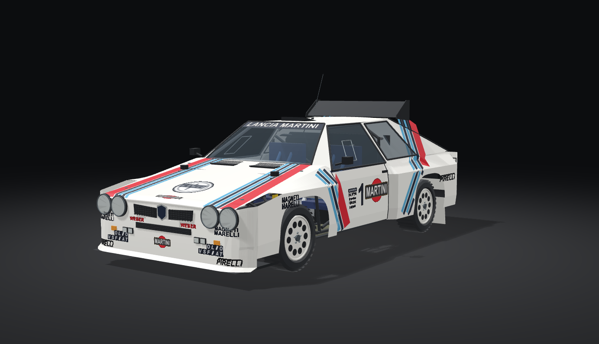
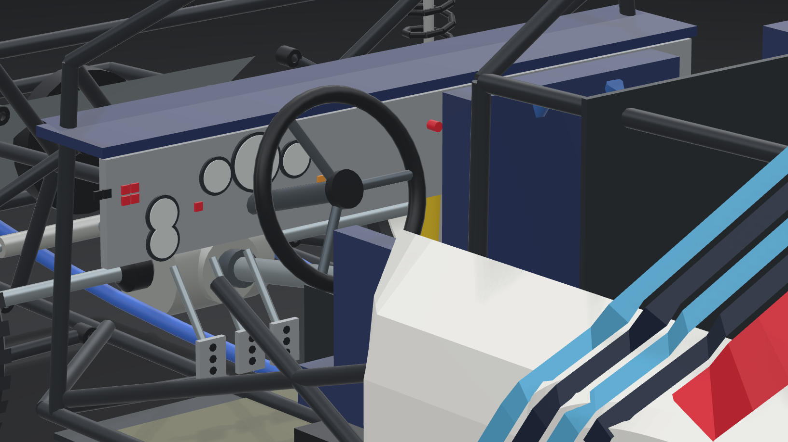
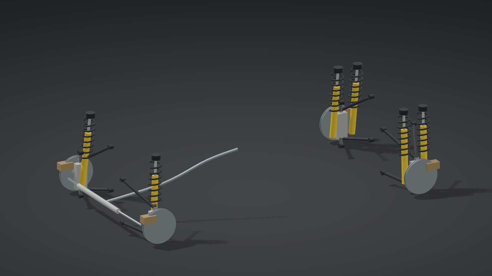
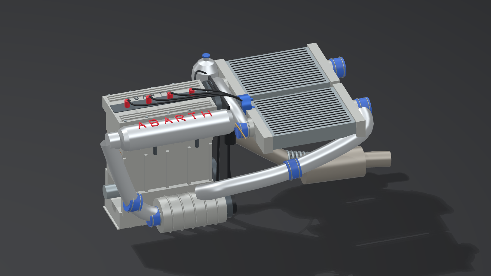

# Lancia Delta S4 · Wilson's Group B Archive

[← Back to the catalogue](../../README.md)

[Chinese viewer](https://wilsonmah.github.io/group_b_archive/cars/lancia-delta-s4/?lang=zh) · [English viewer](https://wilsonmah.github.io/group_b_archive/cars/lancia-delta-s4/?lang=en)



The 1986 Lancia Delta S4 in Martini Racing livery, car Nº 1. Download the repository and open `index.html` in this folder in any WebGL browser to use it offline; the viewer embeds the model and textures.

## Body and livery

- **Proportions:** scaled from the side view of a 1986 rally-car four-view drawing, using the 2.440 m wheelbase. Overall length is about 4.02 m, width 1.88 m (published figures: 3.990 m long, 1.880 m wide, 1.344 m high).
- **Side calibration:** the model's side silhouette was overlaid on the drawing; the wheels line up exactly and the bonnet, roof and engine-cover line are within about 2–3 cm. From that overlay:
  - The arch tops are at about 0.68 m.
  - The door shut lines are 0.66 m ahead of and 0.38 m behind the wheelbase centre.
  - The windscreen header is at 1.27 m, 0.27 m ahead of the centre.
- **Front and rear calibration:** compared side by side with head-on, rear and 3/4 photographs.
  - The headlamp pairs are centred 0.55 m and 0.745 m from the centreline.
  - The grille is two narrow slots either side of the shield, with the intake and number plate below.
  - The roof wing stands nearly upright.
- **Shape:**
  - Square box flares over both axles with rounded-square wheel openings, and a waistline crease along the doors.
  - The nose face wraps round into the front flares at each corner, with the outer headlamps following the curve, and a small black air scoop sits at the front of the roof.
  - Front: four round headlamps, a split grille with the Lancia shield, a long intake slot and a deep spoiler.
  - Two louvred radiator outlets in the bonnet just ahead of the windscreen.
  - Rear: a fixed side window behind the B-pillar in a solid rear quarter, a black louvred engine cover sloping to the tail, and a black wing standing upright at the back of the roof.
- **Tail:** a full-width black mesh panel with square tail lamps, a black MARTINI RACING band above it and PIRELLI either side of the plate below it. Below that the tail is open over the exhaust. White mud flaps carry MARTINI roundels.
- **Livery:** from the studio and event photos.
  - **Front ribbons:** wide Martini ribbons run along both bonnet edges, red outermost, drawing in towards the windscreen, then turn down across the front of each door.
  - **Rear ribbons:** a second set rises from the sill just ahead of each rear wheel, behind the side window, to the roof, with the wide red band rearmost.
  - **Decals:** the MARTINI roundel, number 1 and the sponsor stack sit on the doors between the two ribbon sets. The front carries MARTINI on the bonnet nose and lower panel, WEBER, MAGNETI MARELLI, OLIO VSFIAT and PIRELLI, laid out as on the head-on photo. The Lancia roundel is on the bonnet, a LANCIA MARTINI banner on the windscreen and LANCIA MARTINI on the roof wing.
  - **Aspect ratios:** every graphic keeps its artwork's aspect ratio.
- **Lamp pod:** the four-lamp night pod can be switched on from the vehicle page; it is off by default, as in the studio photo.

## Mechanicals

- **Spaceframe:** chrome-molybdenum steel tubes, with a central cell and integrated roll cage, front and rear subframes, a split cabin bulkhead and fuel cells under the seats.
- **Engine (39 parts):** a 1,759 cm³ (88.5 × 71.5 mm) 16-valve Lancia 233 ATR 18S inline-four, longitudinal and mid-mounted behind the cabin, with the firing order 1-3-4-2. Details follow photos of preserved engines and an S4 engine bay:
  - **Block and head:** a silver block and a plain ribbed cast-alloy cam cover carrying four red plug caps. The HT leads run back to a blue-capped distributor and coil at the timing end.
  - **Intake:** a long polished intake log with red ABARTH lettering, five short runners, and a brass fuel rail with red-topped injectors.
  - **Exhaust:** a long four-into-one tubular header sweeps down and back to a collector. A KKK turbocharger follows, with a tall polished wastegate, then a downpipe with a flex joint and the silencer.
  - **Twin-charging, in series:** a copper pipe takes the turbo's compressed air to the first of two finned intercoolers, which stand side by side beyond the timing end under the engine cover. Polished pipes with blue silicone couplers carry it to the second intercooler, then to the belt-driven Abarth Volumex supercharger, and on into the intake log.
  - **Teardown:**
    - **Down:** the sump and crankshaft.
    - **Up:** the pistons, head, valves, camshafts, cam cover and plug leads.
    - **Out to the intake side:** the intake log, fuel rail and supercharger.
    - **Out to the exhaust side:** the header, turbo, wastegate and downpipe.
    - **Up and out:** the two intercoolers and their pipes.
- **Gearbox and 4WD (37 parts):** a Hewland five-speed gearbox sits ahead of the engine, with the centre differential at its front.
  - A front propshaft runs forward to the front differential.
  - A transfer drop and rear propshaft run back beneath the engine to the rear differential.
  - Each differential has a fixed case and a separate crownwheel and carrier.
  - The gear pairs, reverse idler, sliding collars and selector forks are separate parts.
- **Suspension (27 parts):** double wishbones all round in black tube with ball joints, and yellow damper bodies with black springs and top mounts (open-tail photo). There is a single coil-over per front wheel and twin coil-overs per rear wheel. There are ventilated discs with four-piston calipers and rack-and-pinion steering.
- **Cockpit:** from a photo of a preserved car.
  - A brushed-aluminium dashboard under a navy felt top pad, with a large central rev counter, smaller gauges, red and amber switches, a battery cut-off and the co-driver's electronics box.
  - A black three-spoke wheel with a yellow centre marker.
  - Navy bucket seats with harnesses, drilled alloy pedals, a Kevlar floor, and a tall gear lever on a foil-wrapped tunnel.





- **Cooling:** a front-mounted water radiator and fan breathing out through the bonnet outlet, with coolant lines running back to the engine.
- Internal structures without public drawings are reconstructed from public descriptions, period cutaway drawings and photos, for study and visual reference only.

## Motion study


The "运转 / Run" tab opens a see-through view of the car, with close-ups of the powertrain, the engine and the gearbox.

- **Suspension travel:** in the front- and rear-axle views, a slider (or the road-undulation button) moves the wheels in heave, roll or single-wheel mode. Each corner is a four-bar linkage solved from the double-wishbone pivots; the coil-over swings with the lower arm and extends along its axis, and the half-shaft and track rod follow. The panel reports wheel travel, camber change, spring length and wheel-centre shift. Bump steer and anti-roll bar twist are not modelled.

- **Engine:** the crankshaft, four connecting rods and pistons are driven by one slider-crank model. The two camshafts turn at half crank speed and open each cylinder's valves. The panel shows each cylinder's stroke in the firing order 1 → 3 → 4 → 2, one firing every 180°.
- **Gearbox:** in gears 1–5 the input path is shown in gold, the engaged pair and its collar in green, and the output path in blue. Reverse runs through an idler.
- **Four-wheel drive:** the centre differential drives the front and rear propshafts, then the front and rear differentials and four driveshafts. Each wheel rolls at the speed of its own turning radius.
- **Steering:** drag the on-screen steering wheel. The front wheels follow Ackermann geometry at 15° of steering wheel per degree of road wheel; with 300° of lock the inner front wheel turns 22.3° and the outer 18.1°.
- **Not modelled:** wheel travel is not modelled for this car.




## Model files

- [Full car GLB](models/Lancia_Delta_S4.glb)
- [Engine GLB](models/Lancia_Delta_S4_Engine.glb)
- [Gearbox and 4WD GLB](models/Lancia_Delta_S4_Drivetrain.glb)
- [Suspension, steering and brakes GLB](models/Lancia_Delta_S4_Suspension.glb)

To rebuild, run this in this folder with Python 3 (standard library only):

```sh
python src/build.py && python src/export_units.py && python src/pack.py
```

The decal atlas is drawn by `src/atlas.ps1` (Windows PowerShell).

## Sources

- **Four-view drawing:** [GetOutlines · 1986 Lancia Delta S4 Rally Hatchback](https://getoutlines.com/blueprints/26497/1986-lancia-delta-s4-rally-hatchback-blueprints) (CC BY 4.0).
- **Specifications:** [Wikipedia · Lancia Delta S4](https://en.wikipedia.org/wiki/Lancia_Delta_S4). This covers the engine type and capacity, the Volumex and KKK twin-charging, the Hewland gearbox and 4WD, the dimensions and the spaceframe construction.
- **Photographs:** Wikimedia Commons images under Creative Commons licences, used only for comparison and not distributed with the repository. They are by Neil (CC BY 2.0), Jorjum, Tennen-Gas (CC BY-SA 3.0), Andrew Basterfield (CC BY-SA 2.0) and others.

Lancia, Martini and the livery and sponsor names (Pirelli, Magneti Marelli and others) belong to their respective rights holders. This project is an unofficial, independent technical exhibition.
