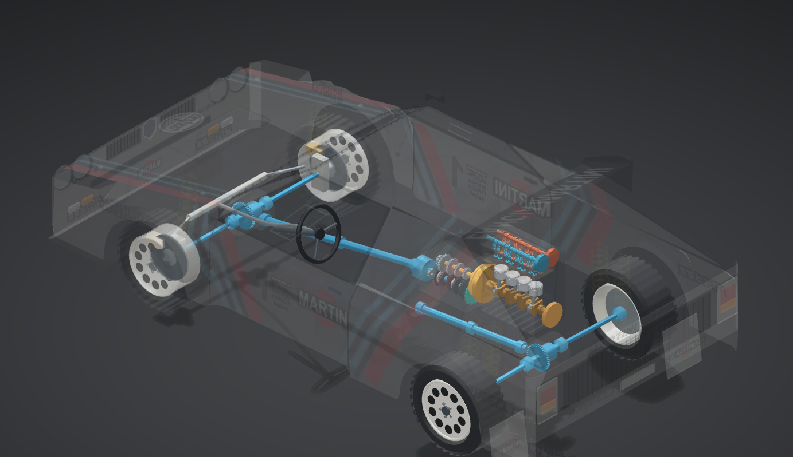
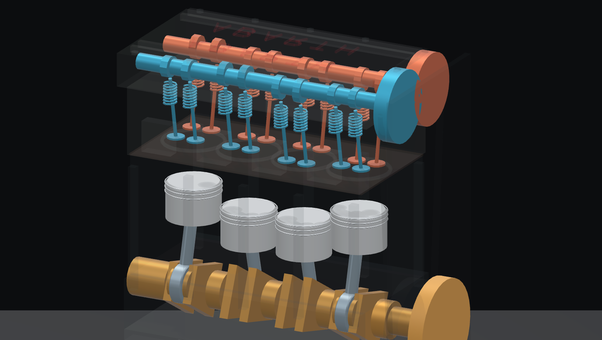

# Lancia Delta S4 · Wilson's Group B Archive

[← Back to the catalogue](../../README.md)

[Chinese viewer](https://wilsonmah.github.io/group_b_archive/cars/lancia-delta-s4/?lang=zh) · [English viewer](https://wilsonmah.github.io/group_b_archive/cars/lancia-delta-s4/?lang=en)


The 1986 Lancia Delta S4 in Martini Racing livery, car Nº 1. Download the repository and open `index.html` in this folder in any WebGL browser to use it offline; the viewer embeds the model and textures.

## Body and livery

- **Proportions:** scaled from the side view of a 1986 rally-car four-view drawing, using the 2.440 m wheelbase. Overall length is about 4.02 m, width 1.88 m (published figures: 3.990 m long, 1.880 m wide, 1.344 m high).
- **Shape:**
  - Square box flares over both axles and a waistline crease along the doors.
  - Front: four round headlamps, a split grille with the Lancia shield, a long intake slot and a deep spoiler.
  - A bonnet outlet for the front radiator.
  - Rear: a solid painted rear quarter with no side window, a black louvred engine cover sloping to the tail, and a black wing standing at the back of the roof.
- **Tail:** a full-width black mesh panel with square tail lamps, MARTINI RACING above it and PIRELLI either side of the plate below it. Below that the tail is open over the exhaust. White mud flaps carry MARTINI roundels.
- **Livery:** from the studio and event photos.
  - **Front ribbons:** Martini ribbons run along both bonnet edges, red outermost, then turn down across the front of each door.
  - **Rear ribbons:** a second set rises diagonally across the rear quarters to the roof, with the wide red band rearmost.
  - **Decals:** the MARTINI roundel, number 1 and the sponsor stack sit on the doors between the two ribbon sets. Front decals include MAGNETI MARELLI, SIEM, PIRELLI and MARTINI. The Lancia roundel is on the bonnet, a LANCIA MARTINI banner on the windscreen and LANCIA MARTINI on the roof wing.
  - **Aspect ratios:** every graphic keeps its artwork's aspect ratio.
- **Lamp pod:** the four-lamp night pod can be switched on from the vehicle page; it is off by default, as in the studio photo.

## Mechanicals

- **Spaceframe:** chrome-molybdenum steel tubes, with a central cell and integrated roll cage, front and rear subframes, a split cabin bulkhead and fuel cells under the seats.
- **Engine (37 parts):** a 1,759 cm³ (88.5 × 71.5 mm) 16-valve Lancia 233 ATR 18S inline-four, longitudinal and mid-mounted behind the cabin, with the firing order 1-3-4-2.
  - **Head:** the cast cam cover carries red ABARTH lettering and red plug caps; there is a tubular four-into-one exhaust manifold.
  - **Twin-charging:** an Abarth Volumex supercharger driven from the crank, and a KKK turbocharger with a polished wastegate dome.
  - **Charge air:** an intercooler on top of the engine and polished charge-air pipes with blue silicone couplers.
  - **Exhaust:** an exhaust with a silencer running out under the tail.
- **Gearbox and 4WD (37 parts):** a Hewland five-speed gearbox sits ahead of the engine, with the centre differential at its front.
  - A front propshaft runs forward to the front differential.
  - A transfer drop and rear propshaft run back beneath the engine to the rear differential.
  - Each differential has a fixed case and a separate crownwheel and carrier.
  - The gear pairs, reverse idler, sliding collars and selector forks are separate parts.
- **Suspension (27 parts):** double wishbones all round, with a single yellow coil-over damper per front wheel and twin coil-over dampers per rear wheel. There are ventilated discs with four-piston calipers and rack-and-pinion steering.
- **Cooling:** a front-mounted water radiator and fan breathing out through the bonnet outlet, with coolant lines running back to the engine.
- Internal structures without public drawings are reconstructed from public descriptions, period cutaway drawings and photos, for study and visual reference only.

## Motion study



The "运转 / Run" tab opens a see-through view of the car, with close-ups of the powertrain, the engine and the gearbox.

- **Engine:** the crankshaft, four connecting rods and pistons are driven by one slider-crank model. The two camshafts turn at half crank speed and open each cylinder's valves. The panel shows each cylinder's stroke in the firing order 1 → 3 → 4 → 2, one firing every 180°.
- **Gearbox:** in gears 1–5 the input path is shown in gold, the engaged pair and its collar in green, and the output path in blue. Reverse runs through an idler.
- **Four-wheel drive:** the centre differential drives the front and rear propshafts, then the front and rear differentials and four driveshafts. Each wheel rolls at the speed of its own turning radius.
- **Steering:** drag the on-screen steering wheel. The front wheels follow Ackermann geometry at 15° of steering wheel per degree of road wheel; with 300° of lock the inner front wheel turns 22.3° and the outer 18.1°.
- **Not modelled:** wheel travel is not modelled for this car.



## Model files

- [Full car GLB](models/Lancia_Delta_S4.glb)
- [Engine GLB](models/Lancia_Delta_S4_Engine.glb)
- [Gearbox and 4WD GLB](models/Lancia_Delta_S4_Drivetrain.glb)
- [Suspension, steering and brakes GLB](models/Lancia_Delta_S4_Suspension.glb)

To rebuild, run this in this folder with Python 3 (standard library only):

```sh
python src/build.py && python src/export_units.py && python src/pack.py
```

The decal atlas is drawn by `src/atlas.ps1` (Windows PowerShell).

## Sources

- **Four-view drawing:** [GetOutlines · 1986 Lancia Delta S4 Rally Hatchback](https://getoutlines.com/blueprints/26497/1986-lancia-delta-s4-rally-hatchback-blueprints) (CC BY 4.0).
- **Specifications:** [Wikipedia · Lancia Delta S4](https://en.wikipedia.org/wiki/Lancia_Delta_S4). This covers the engine type and capacity, the Volumex and KKK twin-charging, the Hewland gearbox and 4WD, the dimensions and the spaceframe construction.
- **Photographs:** Wikimedia Commons images under Creative Commons licences, used only for comparison and not distributed with the repository. They are by Neil (CC BY 2.0), Jorjum, Tennen-Gas (CC BY-SA 3.0), Andrew Basterfield (CC BY-SA 2.0) and others.

Lancia, Martini and the livery and sponsor names (Pirelli, Magneti Marelli and others) belong to their respective rights holders. This project is an unofficial, independent technical exhibition.
