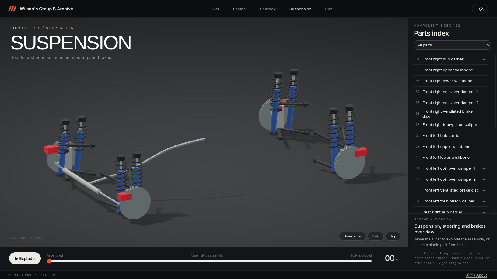
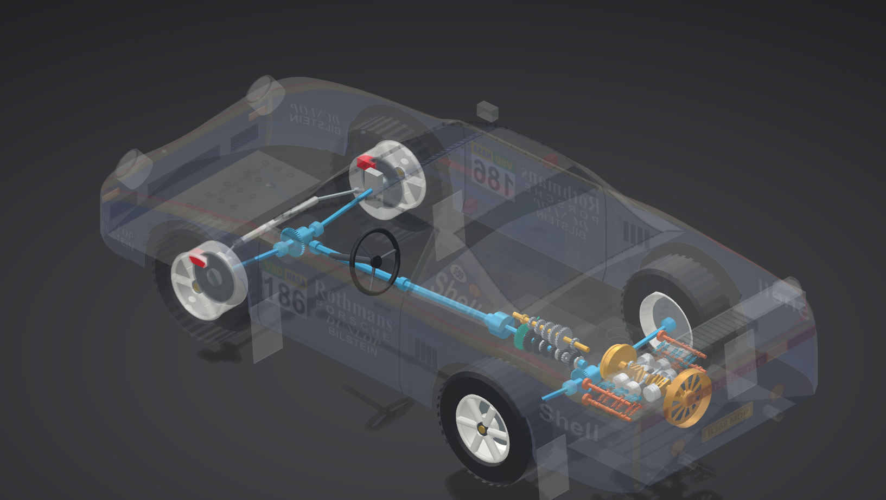
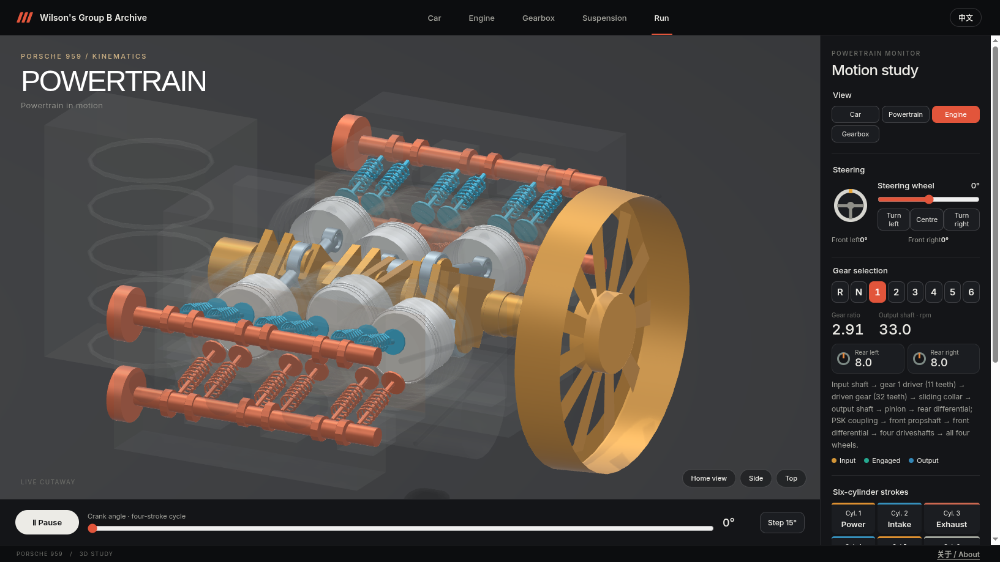

# Porsche 959 · Wilson's Group B Archive

[← Back to the catalogue](../../README.md)

[Chinese viewer](https://wilsonmah.github.io/group_b_archive/cars/porsche-959/?lang=zh) · [English viewer](https://wilsonmah.github.io/group_b_archive/cars/porsche-959/?lang=en)


The Porsche 959 in the Rothmans livery of the Paris–Dakar car Nº 186 (1986). Download the repository and open `index.html` in this folder in any WebGL browser to use it offline; the viewer embeds the model and textures.

> **Status: calibrated against photos.** The body was rebuilt and checked against six photographs of the Rothmans Paris–Dakar cars: side, front three-quarter, rear and snow shots, and the car at auction. The proportions, profile, glasshouse, loop wing, lamps and livery placement follow those photos. Hidden structure is reconstructed, not measured.

## Body and livery

- **Proportions:** scaled to the published 959 figures: wheelbase 2.272 m, length 4.26 m, width 1.84 m. The overhangs are set 911-style, short at the front and long at the rear. Wheel-centre half-tracks are 0.752 m front and 0.775 m rear. From the photos the car sits high, on tall tyres (rolling radius 0.36 m), with chunky rally tread and white five-spoke wheels.
- **Shape:** the body is lofted from smooth cross-sections, so the lines run without kinks from nose to tail.
  - **Nose:** a low sloping bonnet between front-wing crests that stand above it. The two round headlamps sit in the tops of the wings. A deep blue bumper has three black intakes, amber indicators, a skid plate and a lip.
  - **Glasshouse:** a steeply raked windscreen, a short roof and one long fastback falling to the tail. The rear quarter windows are covered by black panels carrying Shell, the 959 oval and the pecten.
  - **Roof:** two red rally beacons on posts and a whip aerial.
  - **Sides:** wide hips over the rear axle, with four black intake slots in each rear wing behind the door.
  - **Tail:** the 959's integrated loop wing spans the tail between the two rear wings, with the black intercooler intake visible beneath it. Below it are a full-width red reflector strip with PORSCHE across it, tail lamps and amber indicators at each end, a yellow plate (B368 MDP), twin tailpipes and an underguard.
  - **Mud flaps:** large white flaps behind all four wheels.
- **Livery:** the roof, bonnet and upper body are white, and the lower body, bumper and tail panel are royal blue.
  - **Stripes:** a gold band edged above with a thin red line runs along the top of the blue. It sits just under the side windows on the doors, sweeps down the front wings to cross the nose above the bumper, and follows the rear hips to the tail.
  - **Door:** the Nº 186 panel with its VSD and NASA header sits at the front of the door. The Rothmans, PORSCHE, DUNLOP and BILSTEIN stack is behind it.
  - **Elsewhere:** DUNLOP and BILSTEIN ahead of the front wheels, and Shell on the rear hips. A blue Rothmans VSD banner crosses the top of the windscreen, and blue, red and blue stripes run along the roof. Rothmans is on the bonnet, and there are Shell pectens either side of the plate.
  - **Aspect ratios:** every graphic keeps its artwork's aspect ratio.
- **Atlas:** the decals are drawn by `src/atlas.ps1` with System.Drawing (Windows PowerShell 5.1 or later).

## Mechanicals

- **Engine (58 parts):** a 2,849 cm³ (95 × 67 mm) flat-six, mounted longitudinally behind the rear axle, with the firing order 1-6-2-4-3-5. Details follow public descriptions of the engine:
  - **Block and heads:** air-cooled finned barrels under water-cooled four-valve heads, one per bank. Each bank has an intake and an exhaust camshaft, and every cylinder has two intake and two exhaust valves with springs.
  - **Crank and rods:** a six-throw crankshaft in a magnesium case, with six rods and pistons on a dry-sump system.
  - **Cooling and ancillaries:** a crank-driven axial cooling fan with its shroud, an alternator and belt, and timing chains.
  - **Intake and fuel:** an air plenum on top, six runners and a fuel rail with injectors on each bank.
  - **Exhaust and turbocharging:** six pipes run to two KKK turbochargers (a larger and a smaller one, as in the sequential system), with wastegates, then to a silencer and twin tailpipes.
  - **Intercoolers:** two air-to-air intercoolers sit in the rear flanks, joined to the plenum by charge pipes.
  - **Teardown:**
    - **Sideways, with each bank:** the barrels, heads, gaskets, camshafts, valves and cam covers.
    - **Up:** the plenum and runners.
    - **Down:** the sump and exhaust manifolds.
    - **Rearwards:** the turbochargers.
    - **Outwards:** the two intercoolers.
- **Gearbox and four-wheel drive (37 parts):** a six-speed gearbox sits between the rear wheels, ahead of the engine.
  - **Gear train:** six constant-mesh gear pairs, a reverse train with an idler, four sliding collars and four selector forks.
  - **Rear drive:** the output shaft ends in a pinion that drives the rear differential directly.
  - **Front drive:** a PSK (Porsche Steuerung Kupplung) multi-plate coupling at the front of the gearbox sends drive forward through a propshaft in the tunnel to the front differential. The real coupling varies the torque split; here it is modelled as a clutch pack.
  - **Differentials:** each has a fixed case and a separate crownwheel and carrier.
- **Suspension (32 parts):** double wishbones at both axles, each with two side-by-side blue spring-dampers (the real car's ride height was adjustable). There are ventilated discs with four-piston calipers and rack-and-pinion steering.
- **Chassis and cockpit:** a steel monocoque with a welded roll cage, a front subframe and a rear engine cradle. The cockpit is basic: a dash with five gauges, two bucket seats with harnesses, a steering wheel, pedals and a gear lever.
- **Cooling:** a front water radiator and fan, with coolant lines running back to the rear heads.
- Internal structures without public drawings are reconstructed from public descriptions and period cutaway drawings, for study and visual reference only.



## Motion study



The "运转 / Run" tab opens a see-through view of the car, with close-ups of the powertrain, the engine and the gearbox.

- **Suspension travel:** in the front- and rear-axle views, a slider (or the road-undulation button) moves the wheels in heave, roll or single-wheel mode. Each corner is a four-bar linkage solved from the double-wishbone pivots; the damper pair swings with the lower arm and extends along its axis, and the half-shaft and track rod follow. The panel reports wheel travel, camber change, spring length and wheel-centre shift. Bump steer and anti-roll bar twist are not modelled.
- **Engine:** the crankshaft, six connecting rods and six horizontally opposed pistons are driven by one slider-crank model; opposing pistons share a crank-pin direction and move together. The four camshafts turn at half crank speed and open each cylinder's valves. The panel shows each cylinder's stroke in the firing order 1 → 6 → 2 → 4 → 3 → 5, one firing every 120°.
- **Gearbox:** in gears 1–6 the input path is shown in gold, the engaged pair and its collar in green, and the output path in blue. Reverse runs through an idler.
- **Four-wheel drive:** the output shaft drives the rear differential through the pinion, and the PSK coupling drives the front propshaft, front differential and the four driveshafts. Each wheel rolls at the speed of its own turning radius. The viewer models the PSK as a fixed split with open differentials, not the real variable torque split.
- **Steering:** drag the on-screen steering wheel. The front wheels follow Ackermann geometry at 15° of steering wheel per degree of road wheel; with 300° of lock the inner front wheel turns 22.5° and the outer 18.0°.




## Model files

- [Full car GLB](models/Porsche_959.glb)
- [Engine GLB](models/Porsche_959_Engine.glb)
- [Gearbox and 4WD GLB](models/Porsche_959_Drivetrain.glb)
- [Suspension, steering and brakes GLB](models/Porsche_959_Suspension.glb)

To rebuild, run this in this folder. The generators need only Python 3's standard library; the decal atlas needs Windows PowerShell.

```powershell
powershell -File src/atlas.ps1
python src/build.py; python src/export_units.py; python src/pack.py
```

## Sources

- **Specifications:** the published 959 figures for wheelbase, track, overall dimensions, engine type and capacity (2,849 cm³, 95 × 67 mm), six-speed gearbox, PSK four-wheel drive and double-wishbone suspension with two dampers per wheel. These are quoted from memory and have not been re-checked against a source. Check them before relying on them.
- **Body, livery and stance:** six photographs of the Rothmans Paris–Dakar 959s, used only for comparison and not distributed with the repository. They are:
  - a side view;
  - front and front three-quarter views;
  - the Nº 185 car in snow;
  - a rear view of the Nº 186 car;
  - Nº 186 at auction.

Porsche, 959, Rothmans and the livery and sponsor names belong to their respective rights holders. This project is an unofficial, independent technical exhibition.
