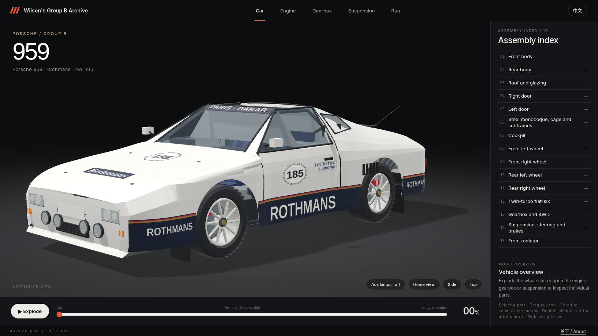
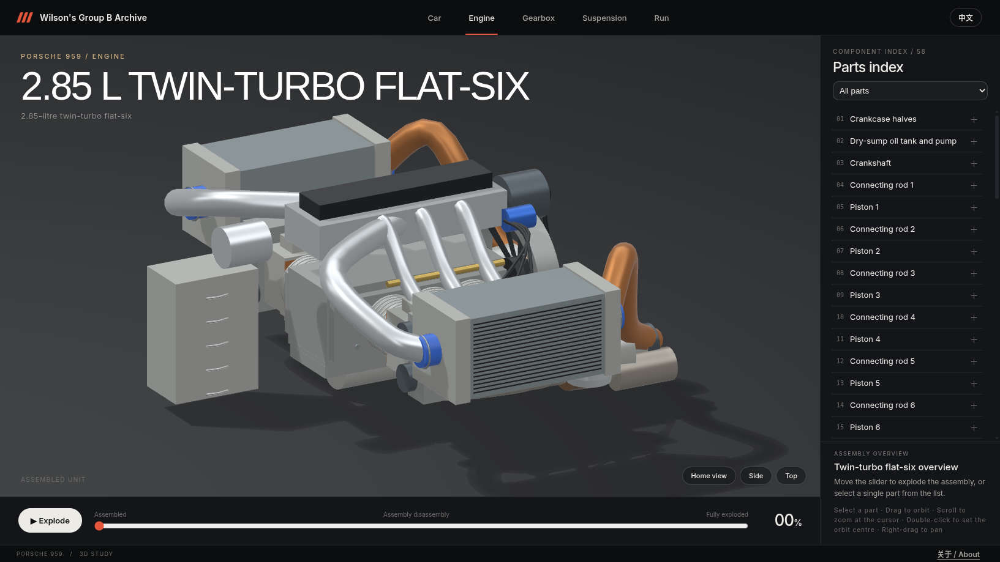

# Porsche 959 · Wilson's Group B Archive

[← Back to the catalogue](../../README.md)

[Chinese viewer](https://wilsonmah.github.io/group_b_archive/cars/porsche-959/?lang=zh) · [English viewer](https://wilsonmah.github.io/group_b_archive/cars/porsche-959/?lang=en)



The Porsche 959 in the Rothmans livery of the Paris–Dakar car, Nº 185 (Metge / Lemoyne, 1986). Download the repository and open `index.html` in this folder in any WebGL browser to use it offline; the viewer embeds the model and textures.

> **Status: first pass.** Unlike cars 01–03, the body and livery of this car have **not** yet been calibrated line by line against period photographs. The shape is built from published dimensions and the usual descriptions of the car, and the Rothmans livery is drawn from the same. Expect the silhouette (nose, fenders, greenhouse) and the graphics to differ from the real car in detail. The mechanicals, which are the main point of the study, are complete and run. A photo-calibration pass is the next step, as it was for the other cars.

## Body and livery

- **Proportions:** scaled to the published 959 figures: wheelbase 2.272 m, length 4.26 m, width 1.84 m, height about 1.28 m. Wheel-centre half-tracks are 0.752 m front and 0.775 m rear.
- **Shape:**
  - A low sloping nose over the luggage bay, with a rectangular headlamp in each wing, two round driving lamps either side in the bumper and a deep spoiler lip.
  - A steeply raked windscreen, a short roof, and one long fastback falling to the tail.
  - Wide flared hips over the rear axle, with five intake slats behind each door for the intercoolers.
  - A louvred engine lid, a full-width tail panel with a lamp bar and twin tailpipes, and mud flaps on all four wheels.
- **Livery:** a white body with a navy lower band edged with gold and red pinstripes.
  - **Lettering:** ROTHMANS runs along both sides, on the bonnet and on the tail, with a PARIS – DAKAR banner across the top of the windscreen.
  - **Numbers and names:** Nº 185 sits in a white roundel on each door and on the bonnet, and the crew names R. METGE and D. LEMOYNE are on the doors.
  - **Aspect ratios:** every graphic keeps its artwork's aspect ratio.
- **Atlas:** the decals are drawn by `src/atlas.py` (Pillow), so they can be regenerated on any platform.

## Mechanicals

- **Engine (58 parts):** a 2,849 cm³ (95 × 67 mm) flat-six, mounted longitudinally behind the rear axle, with the firing order 1-6-2-4-3-5. Details follow public descriptions of the engine:
  - **Block and heads:** air-cooled finned barrels under water-cooled four-valve heads, one per bank. Each bank has an intake and an exhaust camshaft, and every cylinder has two intake and two exhaust valves with springs.
  - **Crank and rods:** a six-throw crankshaft in a magnesium case, with six rods and pistons on a dry-sump system.
  - **Cooling and ancillaries:** a crank-driven axial cooling fan with its shroud, an alternator and belt, and timing chains.
  - **Intake and fuel:** an air plenum on top, six runners and a fuel rail with injectors on each bank.
  - **Exhaust and turbocharging:** six pipes run to two KKK turbochargers (a larger and a smaller one, as in the sequential system), with wastegates, then to a silencer and twin tailpipes.
  - **Intercoolers:** two air-to-air intercoolers sit in the rear flanks, joined to the plenum by charge pipes.
  - **Teardown:**
    - **Sideways, with each bank:** the barrels, heads, gaskets, camshafts, valves and cam covers.
    - **Up:** the plenum and runners.
    - **Down:** the sump and exhaust manifolds.
    - **Rearwards:** the turbochargers.
    - **Outwards:** the two intercoolers.
- **Gearbox and four-wheel drive (37 parts):** a six-speed gearbox sits between the rear wheels, ahead of the engine.
  - **Gear train:** six constant-mesh gear pairs, a reverse train with an idler, four sliding collars and four selector forks.
  - **Rear drive:** the output shaft ends in a pinion that drives the rear differential directly.
  - **Front drive:** a PSK (Porsche Steuerung Kupplung) multi-plate coupling at the front of the gearbox sends drive forward through a propshaft in the tunnel to the front differential. The real coupling varies the torque split; here it is modelled as a clutch pack.
  - **Differentials:** each has a fixed case and a separate crownwheel and carrier.
- **Suspension (32 parts):** double wishbones at both axles, each with two side-by-side blue spring-dampers (the real car's ride height was adjustable). There are ventilated discs with four-piston calipers and rack-and-pinion steering.
- **Chassis and cockpit:** a steel monocoque with a welded roll cage, a front subframe and a rear engine cradle. The cockpit is basic: a dash with five gauges, two bucket seats with harnesses, a steering wheel, pedals and a gear lever.
- **Cooling:** a front water radiator and fan, with coolant lines running back to the rear heads.
- Internal structures without public drawings are reconstructed from public descriptions and period cutaway drawings, for study and visual reference only.


## Motion study


The "运转 / Run" tab opens a see-through view of the car, with close-ups of the powertrain, the engine and the gearbox.

- **Suspension travel:** in the front- and rear-axle views, a slider (or the road-undulation button) moves the wheels in heave, roll or single-wheel mode. Each corner is a four-bar linkage solved from the double-wishbone pivots; the damper pair swings with the lower arm and extends along its axis, and the half-shaft and track rod follow. The panel reports wheel travel, camber change, spring length and wheel-centre shift. Bump steer and anti-roll bar twist are not modelled.
- **Engine:** the crankshaft, six connecting rods and six horizontally opposed pistons are driven by one slider-crank model; opposing pistons share a crank-pin direction and move together. The four camshafts turn at half crank speed and open each cylinder's valves. The panel shows each cylinder's stroke in the firing order 1 → 6 → 2 → 4 → 3 → 5, one firing every 120°.
- **Gearbox:** in gears 1–6 the input path is shown in gold, the engaged pair and its collar in green, and the output path in blue. Reverse runs through an idler.
- **Four-wheel drive:** the output shaft drives the rear differential through the pinion, and the PSK coupling drives the front propshaft, front differential and the four driveshafts. Each wheel rolls at the speed of its own turning radius. The viewer models the PSK as a fixed split with open differentials, not the real variable torque split.
- **Steering:** drag the on-screen steering wheel. The front wheels follow Ackermann geometry at 15° of steering wheel per degree of road wheel; with 300° of lock the inner front wheel turns 22.5° and the outer 18.0°.




## Model files

- [Full car GLB](models/Porsche_959.glb)
- [Engine GLB](models/Porsche_959_Engine.glb)
- [Gearbox and 4WD GLB](models/Porsche_959_Drivetrain.glb)
- [Suspension, steering and brakes GLB](models/Porsche_959_Suspension.glb)

To rebuild, run this in this folder with Python 3 (the generators use only the standard library; the decal atlas needs Pillow):

```sh
python3 src/atlas.py && python3 src/build.py && python3 src/export_units.py && python3 src/pack.py
```

## Sources

- **Specifications:** the published 959 figures for wheelbase, track, overall dimensions, engine type and capacity (2,849 cm³, 95 × 67 mm), six-speed gearbox, PSK four-wheel drive and double-wishbone suspension with two dampers per wheel. These are quoted from memory and have not been re-checked against a source. Check them before relying on them.
- **Livery:** the usual descriptions of the Rothmans Paris–Dakar car of 1986; no reference photographs have been used yet.

Porsche, 959, Rothmans and the livery and sponsor names belong to their respective rights holders. This project is an unofficial, independent technical exhibition.
